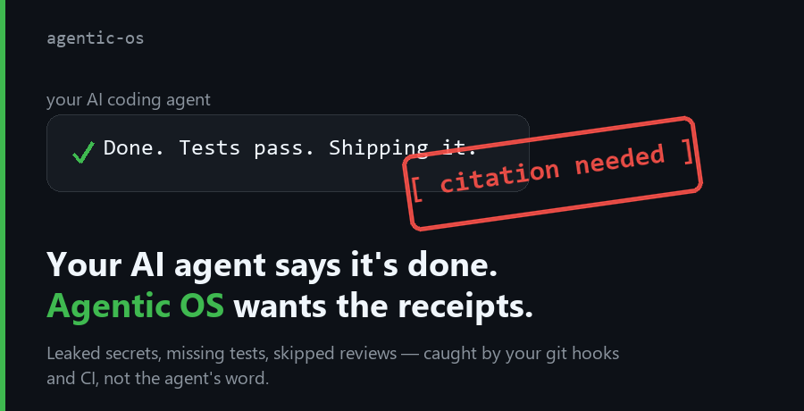
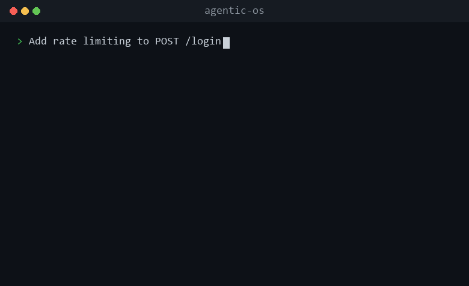
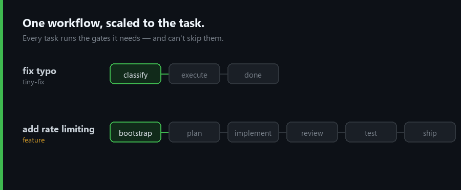

<h1 align="center">Agentic OS</h1>

<p align="center">
  <strong>"Done." — your AI coding agent, about code it didn't test.</strong><br/>
  A rules file <em>asks</em> your agent to behave. Agentic OS <strong>checks that it did</strong> — once you switch on the git hook and a CI job (the installer prints both), a leaked secret fails the commit and a work trail missing a phase or its evidence fails the validator. Backstops you control. The validator checks the record the agent keeps, so it catches a phase missing from that record, not a faked record or a task that never opened one.
</p>

<p align="center">
  <strong>A governance-first layer for AI coding agents</strong> — guardrails and a gated workflow for Claude Code, Codex, Cursor, Copilot, Antigravity, or any Markdown-reading agent.
</p>

<p align="center">
  <a href="https://github.com/KbWen/agentic-os/releases"></a>
  <a href="https://github.com/KbWen/agentic-os/actions/workflows/validate.yml"></a>
  <a href="https://github.com/KbWen/agentic-os/actions/workflows/security.yml"></a>
  <a href="https://opensource.org/licenses/MIT"></a>
  &nbsp;·&nbsp;
  <a href="docs/README_zh-TW.md">繁體中文</a> ·
  <a href="CONTRIBUTING.md">Contributing</a> ·
  <a href="CHANGELOG.md">Changelog</a>
</p>

<p align="center">
  
</p>

<p align="center"><sub>It checks the evidence behind what your AI coding agent claims — secrets and tests in your git hooks and CI, phase records in a local validator. Here's a gate firing:</sub></p>

<p align="center">
  
</p>

The `/bootstrap`, `/review`, and `/ship` above are plain text prompts — your agent maps them to the workflow files in the repo, so they run the same in Cursor or Codex as in Claude Code.

Or run a gate yourself, no install — the credential scan that catches a leaked key before it reaches git history:

```sh
bash demo/run.sh          # Windows (PowerShell): pwsh demo/run.ps1
```

<p align="center">
  
</p>

<details>
<summary>Full terminal output</summary>

```text
  An AI agent wrote this file and reported: "Done — config added."
  ----------------------------------------------------------------
    DB_HOST=prod.internal
    aws_access_key_id = AKIA****************
  ----------------------------------------------------------------

  Without a gate, that commit lands and the key is in git history forever.
  Agentic OS runs this before the commit is allowed:

    $ scan_credentials.py config.env

CREDENTIAL PATTERN(S) DETECTED (values redacted):
  config.env:2: aws-access-key-id
Rotate the exposed secret, remove it from the change, then retry.

  Commit BLOCKED. The agent said "done"; the machine said no — and it
  redacted the value instead of echoing your secret back at you.
```

</details>

Your agent can still cut a corner. What it can't do is get a leaked secret past the hook, or a failing test past CI, once they're on — those run whether it cooperates or not. Reviews are checked from the work trail the agent writes: a missing review record fails the local check, a faked one does not. The key above is generated at runtime and redacted on output, so the demo never stores a real secret.

## Usable on day one

Three parts work before you wire up anything:

- **A standalone credential gate.** `scan_credentials.py` scans the files you give it, a staged diff (`--staged`) or a commit range (`--range`), with redacted output — the demo above. Two lines from the installer's output make it your pre-commit hook.
- **Memory that survives a new session.** Each task keeps a work log of decisions, evidence and gate receipts, and `/handoff` writes a resume block, so the next session or agent picks up from the log instead of the chat.
- **14 expert checklists, attached by task type** — an auth-security pass on login code, forward-only checks on a migration. The list is under *What you get*.

## Rules vs. enforcement

A rules file — Cursor Rules, a plain `AGENTS.md` — is a prompt the agent can ignore. Agentic OS keeps that discipline (plan before editing, no unasked-for refactors) and adds a layer the agent doesn't control. **A fresh install runs nothing by itself**; the installer ends by printing the commands that turn it on.

| Failure mode | What catches it | On after install? |
|:---|:---|:---|
| A secret committed to history | `scan_credentials.py` (shown above) | **No.** Enable the pre-commit hook (two lines) or add the scan to your CI |
| A phase skipped with no evidence | `validate.sh` reads the work trail and fails on a missing phase or evidence | **No.** Run it yourself or in the pre-commit hook. Work logs are gitignored, so CI never sees them |
| "Tests pass" with no tests | Your CI running your real suite | Only where your CI runs your tests |
| Tests recorded as passing, then the code changed (or the run failed) | `record_test_run.py` runs the suite and records the exit code and a fingerprint of the code; `/ship` runs its check, and `validate.sh` fails while the log is active, if the latest run failed before a PASS receipt or the code changed after it | **No.** Run your tests through it. It catches stale or failed runs, not a hand-typed `Test run:` line, a recorded command that is not your real suite, or a tree git cannot read (a WARN) |
| The agent ignores the workflow or a skill checklist | Nothing machine-side | Advisory, the same as a rules file |

The second row is the part a rules file can't reach: `validate.sh` parses each task's work log and fails if a required phase was skipped or its evidence is missing. That check runs where the work logs are: on your machine, by hand or in the opt-in pre-commit hook, which `--no-verify` can skip. Work logs are gitignored, so CI cannot run it. What a required CI job can enforce is the credential scan, your test suite, and `validate.sh`'s structural checks of the framework files; mark those jobs required in branch protection. In this repo that floor is three required checks (`Framework Validation`, `ShellCheck`, `Check Markdown Links`); the security scanning jobs (credential scan, SAST, dependency audit) run on every PR but are not required merge checks unless you add them to branch protection. The Security badge above is this repo running the same credential and SAST gates on its own every push.

## Sits under what you already have

Agentic OS is the enforcement layer. A rules file or a skill pack tells your agent how to behave; this is the part that checks - a secret scan and your tests in your git hooks and CI, which don't take the agent's word, plus a local validator that fails when its work trail is missing a phase. Already have those? Keep them. This sits underneath and turns the discipline they ask for into a check that can fail your commit or your build.

## Gated phases, scaled to risk

Every task runs a gated workflow, and the rigor scales to the risk. Skip a phase and `validate.sh` fails — but a typo doesn't run the same gauntlet as a feature:

```text
  tiny-fix    classify --> execute --> evidence --> done
  quick-win   bootstrap --> plan --> implement --> evidence --> ship
  feature     bootstrap --> spec --> plan --> implement --> review --> test --> ship

  And the ship gate is not a formality:

  ship attempt --> [ no review/test evidence ] --> BLOCKED
  ship attempt --> [ evidence on record ]      --> SHIPPED

  The agent can still cut a corner. It just can't cut this one
  past a check it doesn't control.
```

<p align="center">
  
</p>

The full set of paths, by classification:

| Classification | Required phases |
|:---|:---|
| **tiny-fix** | Classify → Execute → Evidence → Done |
| **quick-win** | Bootstrap → Plan → Implement → Evidence → Ship |
| **feature** | Bootstrap → Spec → Plan → Implement → Review → Test → Handoff → Ship |
| **hotfix** | Bootstrap → Research → Plan → Implement → Review → Test → Ship |
| **architecture-change** | Bootstrap → ADR → Spec → Plan → Implement → Review → Test → Handoff → Ship |

## What you get

| | |
|:---|:---|
| **Machine-enforced backstops** | Once enabled, the failure modes above are caught by your git hooks, the validator, and CI. The secret scan and your tests don't depend on the agent's report; the validator reads the work trail the agent writes, so it catches gaps, not fabrication. |
| **Skills that auto-attach by phase** | The workflow puts the right checklist in front of the agent by task type — TDD on a feature, an auth-security pass on login code — so you don't wire skills by hand. Guidance, not gates. |
| **Memory that survives handoffs** | Decisions and evidence live in one source-of-truth state file, so they carry across sessions and agents instead of resetting with the chat. |
| **Cross-platform** | One set of governance files works across every major AI coding agent — the same rules whichever one you run. |
| **Token-efficient by design** | Governance scales to risk: a tiny-fix skips the heavy guardrails (~5,000 tokens), so you're not paying frontier-model rates to fix a typo. |

<details>
<summary><strong>The 14 skills the workflow auto-attaches by task type</strong></summary>

The workflow attaches these by classification, so the relevant checklist is in front of the agent at the right phase — an auth-security pass when it touches login code, forward-only checks on a migration. They're structured guidance, not machine gates (the gates are the hooks, validator, and CI above); what they remove is the manual wiring.

| Skill | Trigger | Focus |
|:---|:---|:---|
| Test-Driven Development | feature, architecture-change | Red → Green → Refactor cycles |
| Systematic Debugging | bug encounter | 4-phase root cause analysis |
| Red Team / Adversarial | review, test | Classification-based security analysis |
| API Design | API endpoints detected | Endpoint validation enforcement |
| Auth Security | auth code detected | Hashing, tokens, rate limiting |
| Database Design | migration detected | Forward-only ORM-aware migration safety |
| Frontend Patterns | UI components | Component and state management patterns |
| Parallel Agent Dispatching | complex tasks | Coordinated subagent execution |
| Subagent-Driven Development | multi-module tasks | Multi-agent coordination |
| Karpathy Principles | all coding tasks | Behavioral guardrails against common LLM coding mistakes |
| Production Readiness | feature, architecture-change | Pre-ship observability: error sinks, log strategy, rollback telemetry |
| Verification Before Completion | /ship | 5-gate check: Scope → Quality → Evidence → Risk → Communication |
| Git Worktrees | parallel branches | Worktree isolation workflows |
| Doc Lookup | documentation needed | Documentation retrieval strategy |

</details>

<details>
<summary><strong>Multi-agent &amp; memory that survives handoffs</strong></summary>

Built for codebases where several AI sessions — or several people's agents — touch the same repo:

```
.agentcortex/context/
├── current_state.md          # Global project state (single source of truth)
└── work/
    └── <branch-name>.md      # Per-task work log (isolated, evidence + gate receipts)
```

- **One branch = one owner** — prevents concurrent work-log corruption.
- **Single-writer locking** — atomic lock files block clashing sessions per branch (configurable back to advisory).
- **Ship guard** — checks for source-of-truth conflicts before a merge.
- **Session identity** — every AI session records its model name and timestamp, so a handoff is traceable.

</details>

## Works with your agent

| Platform | Status | Integration |
|:---|:---|:---|
| **Claude Code** | Native | `CLAUDE.md` entrypoint + Claude platform guide |
| **OpenAI Codex** | Native | `AGENTS.md`, Codex platform guide, CLI delegation workflow |
| **Google Antigravity** | Native | `GEMINI.md` entrypoint + Antigravity runtime guidance |
| **Cursor** | Compatible | Reads `AGENTS.md` / project-rule style guidance — the slash-commands are plain prompts |
| **GitHub Copilot** | Compatible | Uses repository instructions and guardrail docs |
| **Any LLM agent** | Compatible | Model-agnostic Markdown workflows + evidence rules |

Either way the real floor is the same: the git hooks and CI don't care which agent you run.

## Quick start

```bash
git clone https://github.com/KbWen/agentic-os.git
./agentic-os/installers/deploy_brain.sh --dry-run /path/to/your-project   # preview, no changes
./agentic-os/installers/deploy_brain.sh /path/to/your-project             # deploy
```

Then tell your agent: *"Read `AGENTS.md` and follow it. Do not claim completion until /review and /test pass."* — followed by `/bootstrap` and your task.

| Your starting point | First command |
|:---|:---|
| Brand-new project, multi-feature idea | `/spec-intake` |
| Existing repo adopting Agentic OS | `/audit` (read-only, zero risk) |
| Single concrete task | `/bootstrap` |

Your existing `AGENTS.md`, `CLAUDE.md`, skills and other scaffold files are kept (the framework version lands beside them as `.acx-incoming` to merge); a different file at a core path such as `.agent/rules/` is backed up to `.acx-local`, then replaced. Windows / no-Python mode, updating, customizing without conflicts, turning the CI floor into a required check, and the full entry-point templates → **[docs/INSTALL.md](docs/INSTALL.md)**.

## Running the tests

```bash
# Fast local loop — mirrors what CI runs; skip the slow subprocess tests
python -m pytest tests/ci/ tests/guard/ .agentcortex/tests/ -m "not slow"
```

Full details and the `slow` suite → [CONTRIBUTING.md](CONTRIBUTING.md).

## FAQ

**What is Agentic OS?**
An open-source governance framework for AI coding agents. It gives agents like Claude Code, Codex, Cursor, Copilot, and Antigravity a repeatable workflow — plan, build, review, test, ship — and checks the work trail they leave, so a skipped phase or missing evidence fails the validator instead of passing as "done".

**How do I stop an AI agent from skipping tests or shipping unverified code?**
That's the core of it. Once you enable them, the credential scan and your test suite run in your git hooks and CI, and the phase/evidence validator runs in your local hook — so a leaked secret or a missing test fails the commit or the build, and a review with no record fails the local check. Those records are written by the agent: the validator checks that each phase left one, in order, not that the work behind it happened. The secret scan and your tests are the checks the agent can't talk its way past.

**How is it different from Cursor Rules or a plain `AGENTS.md` file?**
A rules file tells the agent how to behave, and the agent can ignore it. Agentic OS adds the workflow and the checks that hold it to that behavior: phase sequencing, evidence requirements, scope discipline, and a single source of truth that remembers decisions across sessions. The skills and discipline are still guidance the agent follows; what's *enforced* is the part that fails your commit or CI — leaked secrets, missing tests — plus a local check that fails when a phase is missing from the work trail.

**What are the `⚡ ACX` line and the `gate:` block in my agent's replies?**
`⚡ ACX` ends every reply as a runtime marker that the agent loaded the governance files; a reply without it usually means it didn't. It is self-reported, not proof — the persistent check is the validator warning when a work log lacks it. The `gate:` block (`gate`, `classification`, `verdict`, `missing`) is printed before the agent enters `/plan` or `/ship`; `verdict: fail` lists what is missing, and the agent stops there.

**Does it lock me into one AI vendor?**
No. It's model-agnostic Markdown — native entry points for Claude Code (`CLAUDE.md`), Codex (`AGENTS.md`), and Gemini / Antigravity (`GEMINI.md`), and it works with Cursor, Copilot, and any other LLM agent through the same workflow files.

**Is it free?**
Yes — MIT licensed. Fork it and ship it.

## Docs

| Goal | Start here |
|:---|:---|
| Install, update, customize | [Install & Usage](docs/INSTALL.md) |
| Look up every command, the architecture, and the principles | [Reference](docs/reference.md) |
| Choose a model · see real token costs | [Model Guide](docs/AGENT_MODEL_GUIDE.md) · [Lifecycle Benchmark](docs/LIFECYCLE_BENCHMARK.md) |
| The principles & the test standard | [Agent Philosophy](.agentcortex/docs/AGENT_PHILOSOPHY.md) · [Testing Protocol](.agentcortex/docs/TESTING_PROTOCOL.md) |
| Platform-specific notes | [Codex](.agentcortex/docs/CODEX_PLATFORM_GUIDE.md) · [Claude](.agentcortex/docs/CLAUDE_PLATFORM_GUIDE.md) |
| Connect an external knowledge base (optional) | [Connecting a knowledge base](.agentcortex/docs/guides/connecting-a-knowledge-base.md) |

## Contributing

See [CONTRIBUTING.md](CONTRIBUTING.md) — guidelines for contributing as a human or an AI agent.

## License

MIT. See [LICENSE](LICENSE).

<p align="center"><sub>A governance-first layer for AI coding agents. Contributions and feedback welcome.</sub></p>
